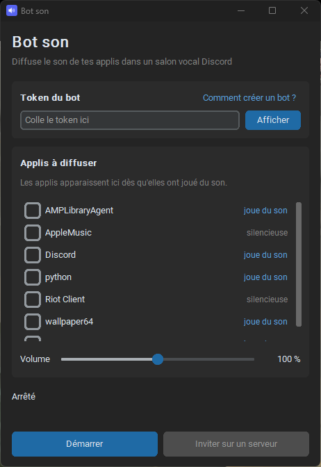

# Bot son

Diffuse le son d'une ou plusieurs applis de ton PC (lecteur audio, navigateur, jeu…) dans un salon vocal Discord, grâce à ton propre bot.

Seul le son des applis que tu choisis est envoyé : pas tes notifications, pas ton micro, pas Discord lui-même. Aucun câble audio virtuel ni Voicemeeter n'est nécessaire.

<p align="center"></p>

## Fonctionnalités

- **Choix des applis à diffuser** : la liste montre toutes les applis qui jouent du son, quelle que soit leur sortie audio. Coche-en une ou plusieurs, leurs sons sont mélangés.
- **Changements en direct** : coche ou décoche une appli pendant la diffusion. Si une appli est fermée puis relancée, elle est reprise automatiquement.
- **Volume** réglable de 0 à 200 %, depuis l'interface ou avec `/volume` dans Discord.
- **Token stocké en sécurité** dans le gestionnaire d'identifiants Windows.
- **Tourne en arrière-plan** : ferme la fenêtre, le bot reste actif dans la zone de notification.
- **Un seul fichier `.exe`**, pas besoin d'installer Python.

## Prérequis

- Windows 10 version 2004 (mai 2020) ou plus récent, ou Windows 11.
- Un compte Discord et un serveur sur lequel tu peux ajouter un bot.

## Installation

1. Télécharge `BotSon.exe` depuis la page [Releases](../../releases/latest).
2. Lance-le. Aucune installation n'est nécessaire.

> **Windows SmartScreen ou l'antivirus le bloque ?** L'exe n'est pas signé numériquement, et les programmes créés avec PyInstaller sont parfois signalés à tort. Clique sur « Informations complémentaires » → « Exécuter quand même », ou compile l'exe toi-même depuis le code source (voir plus bas).

## Créer ton bot Discord

Chaque utilisateur a besoin de son propre bot : un même bot ne peut pas diffuser depuis deux PC en même temps.

1. Ouvre le [portail développeur Discord](https://discord.com/developers/applications) et clique sur **New Application**. Le nom choisi sera celui du bot.
2. Dans l'onglet **Bot**, clique sur **Reset Token**, puis copie le token.
   **Ne le partage jamais** : il donne le contrôle total du bot. S'il fuite, refais *Reset Token* pour l'invalider.
3. Dans Bot son, colle le token et clique sur **Démarrer**.
4. Clique sur **Inviter sur un serveur** et choisis ton serveur. Le lien demande uniquement les permissions nécessaires : voir les salons, se connecter, parler et envoyer des messages.

Le bouton **Comment créer un bot ?** de l'application rappelle ces étapes.

## Utilisation

1. Dans Bot son, coche les applis à diffuser et clique sur **Démarrer**.
2. Dans Discord, rejoins un salon vocal.
3. Dans un salon textuel, tape une commande :

| Commande | Effet |
|---|---|
| `/join` | Le bot rejoint ton salon vocal et diffuse les applis cochées |
| `/leave` | Le bot quitte le salon vocal |
| `/volume pourcent:80` | Règle le volume de la diffusion (0 à 200) |

À côté de chaque appli, l'interface indique son état :

| État | Signification |
|---|---|
| **diffusée** | Le son de l'appli est envoyé au bot |
| **joue du son** | L'appli joue du son mais n'est pas cochée (ou le bot est arrêté) |
| **silencieuse** | L'appli a une session audio mais ne joue rien pour le moment |
| **pas lancée** | L'appli est cochée mais n'est pas ouverte |

Le volume réglé dans Bot son ne change que ce qu'entendent les autres sur Discord. Ton propre volume ne change pas.

## Dépannage

**Une appli n'apparaît pas dans la liste**
Elle n'apparaît qu'après avoir joué au moins un son. Lance une musique ou une vidéo dedans, la liste se met à jour toutes les 3 secondes.

**L'appli n'apparaît pas sous son nom habituel**
Certaines applis jouent le son depuis un processus secondaire au nom différent. Lance un son dans l'appli et coche l'entrée qui passe à **joue du son** à ce moment-là.

**Les commandes `/join`… n'apparaissent pas dans Discord**
Vérifie que le bot est bien sur le serveur et qu'il est en ligne (bouton Démarrer cliqué). Dans Discord, appuie sur `Ctrl+R` pour recharger.

**« Token invalide »**
Le token a été mal copié ou a été réinitialisé. Refais *Reset Token* sur le portail et colle le nouveau. Attention : le lien d'invitation (`https://discord.com/oauth2/...`) n'est pas le token.

**Le bot est dans le salon mais on n'entend rien**
Vérifie que l'appli est marquée **diffusée** dans Bot son, que le son n'est pas coupé dans l'appli elle-même et que le curseur de volume de Bot son n'est pas à 0.

**Où sont les réglages et les journaux ?**
Les réglages sont dans `%APPDATA%\BotSon\config.json` et les erreurs dans `%APPDATA%\BotSon\bot_son.log`. Le token est dans le *Gestionnaire d'identifiants Windows*, sous l'entrée `BotSon`.

## Depuis le code source

Il faut Python 3.11 ou plus récent.

```bash
git clone https://github.com/D0M0I0/bot-son.git
cd bot-son
python -m venv .venv
.venv\Scripts\pip install -r requirements.txt
.venv\Scripts\python app.py
```

Pour compiler l'exe, lance `build.bat`. Le fichier est créé dans `dist\BotSon.exe`.

## Comment ça marche

- **Capture par appli** : Windows (depuis la version 10 2004) permet de capturer le son d'un seul processus et de ses processus enfants. On l'appelle *process loopback capture*. Aucune bibliothèque Python ne l'expose, donc `process_capture.py` appelle directement l'API WASAPI via `ctypes`.
- **Mélange** : chaque appli cochée est capturée en PCM 48 kHz stéréo. `mixer.py` additionne les flux par trames de 20 ms et applique le volume. Le retard est limité à 200 ms.
- **Discord** : `discord.py` encode le son en Opus et l'envoie dans le salon vocal, avec le chiffrement de bout en bout de Discord (DAVE).

| Fichier | Rôle |
|---|---|
| `app.py` | Interface (CustomTkinter) et icône de notification |
| `bot_core.py` | Bot Discord et commandes slash |
| `mixer.py` | Capture de plusieurs applis et mélange |
| `process_capture.py` | Capture du son d'un processus (WASAPI) |
| `sessions.py` | Liste des applis qui ont une session audio |
| `config.py` | Réglages et stockage du token |
| `build.bat` | Compilation en `.exe` avec PyInstaller |

## Limites

- Windows uniquement.
- Le bot diffuse dans un seul salon vocal à la fois par serveur.
- Diffuser de la musique protégée sur un serveur public peut enfreindre les droits d'auteur : c'est ta responsabilité.
